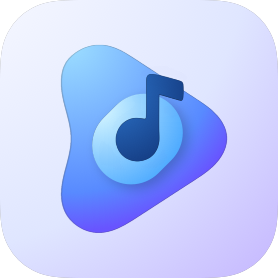
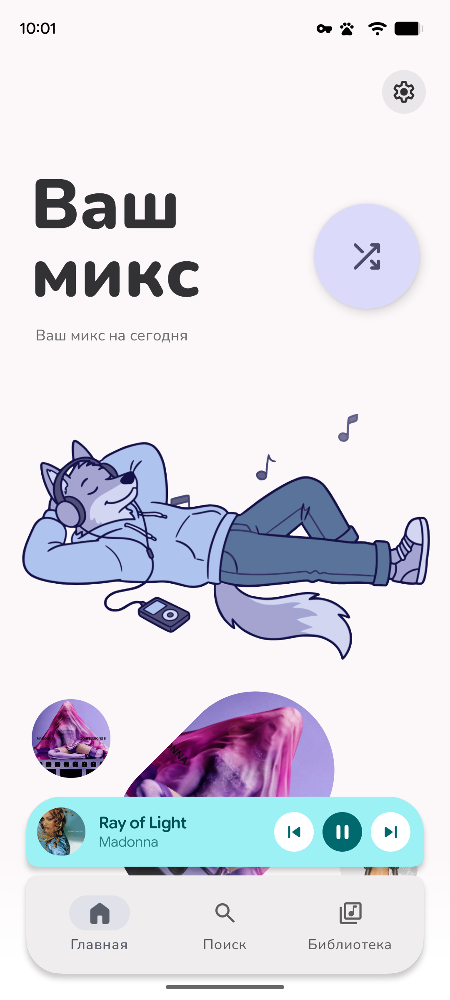
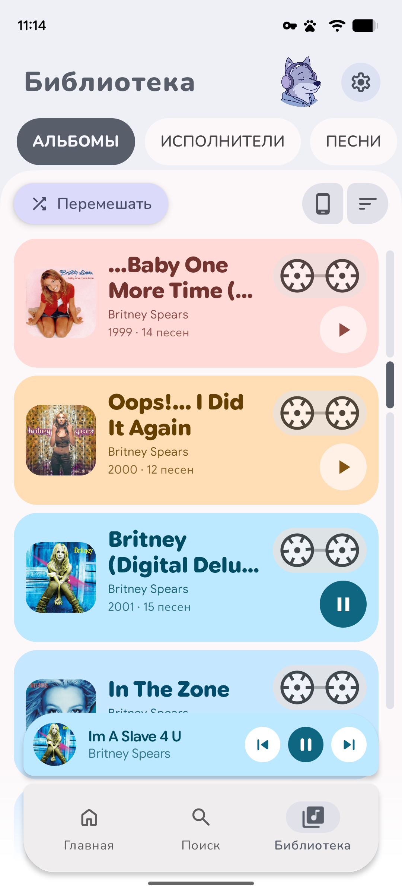
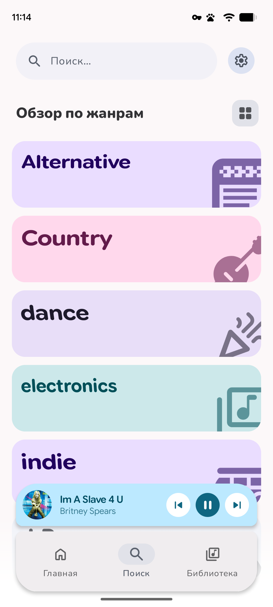
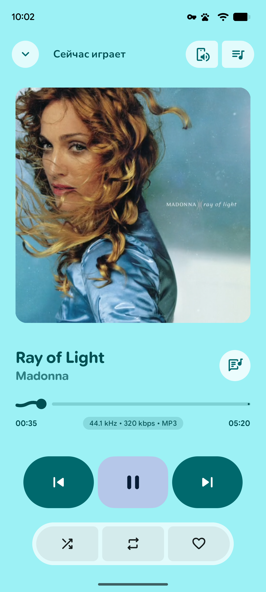
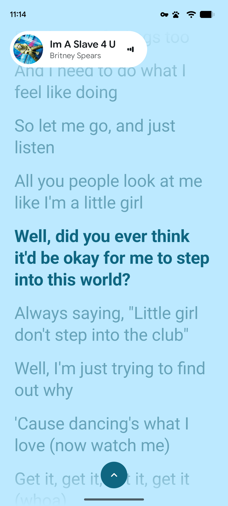
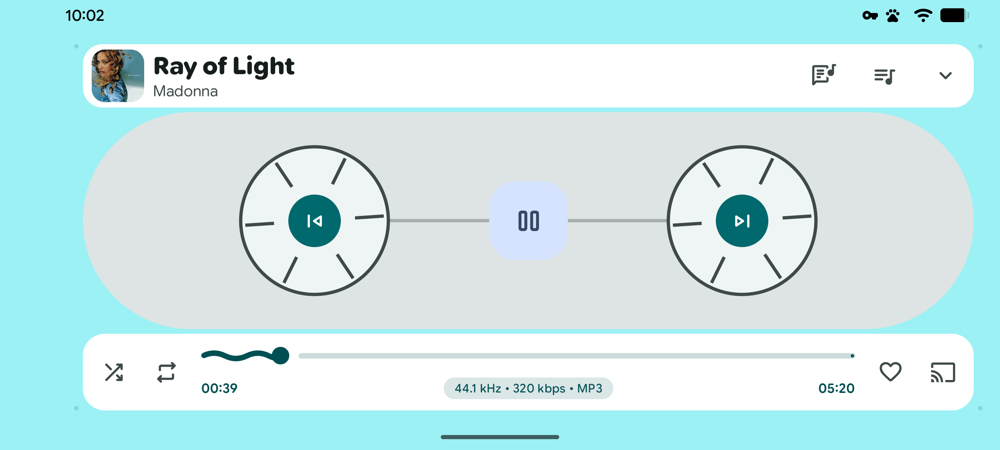

<p align="center">
  
</p>

<h1 align="center">PixelPlayer · MyMod</h1>

<p align="center">
  <strong>Ваша музыка, кассеты и немного волчьего настроения.</strong><br>
  Музыкальный плеер для Android с Material 3 Expressive, динамическими цветами<br>
  и адаптивным интерфейсом для смартфонов, планшетов и складных устройств.
</p>

<p align="center">
  
  
  
  
</p>

<p align="center">
  <a href="#скриншоты">Скриншоты</a> ·
  <a href="#возможности">Возможности</a> ·
  <a href="#установка">Установка</a> ·
  <a href="#сборка-из-исходников">Сборка</a> ·
  <a href="https://github.com/poltoraska/PixelPlay-MyMod/issues">Сообщить об ошибке</a>
</p>

> **Это неофициальный форк PixelPlayer, который развивает [@poltoraska](https://github.com/poltoraska).** Здесь собраны собственные изменения интерфейса, кассетные элементы, маскот и доработки для русского языка, планшетов и Fold.
>
> Оригинальный проект создан [theovilardo](https://github.com/theovilardo): [theovilardo/PixelPlayer](https://github.com/theovilardo/PixelPlayer). Этот репозиторий — [poltoraska/PixelPlay-MyMod](https://github.com/poltoraska/PixelPlay-MyMod). Авторы исходного проекта не отвечают за изменения форка; вопросы по этой версии направляйте в его Issues.

## Скриншоты

Актуальный интерфейс форка на смартфоне. Нажмите на изображение, чтобы открыть его в полном размере.

<table>
  <tr>
    <th width="33%">Главная</th>
    <th width="33%">Библиотека</th>
    <th width="33%">Поиск</th>
  </tr>
  <tr>
    <td align="center"><a href="assets/screenshots/home.png"></a></td>
    <td align="center"><a href="assets/screenshots/library.png"></a></td>
    <td align="center"><a href="assets/screenshots/search.png"></a></td>
  </tr>
</table>

<table>
  <tr>
    <th width="50%">Полноэкранный плеер</th>
    <th width="50%">Тексты песен</th>
  </tr>
  <tr>
    <td align="center"><a href="assets/screenshots/player.png"></a></td>
    <td align="center"><a href="assets/screenshots/lyrics.png"></a></td>
  </tr>
</table>

<p align="center"><strong>Кассетный плеер · смартфон в горизонтальной ориентации</strong></p>
<p align="center">
  <a href="assets/screenshots/cassette-player.png"></a>
</p>

## Что отличает этот форк

- **Живые обложки.** Экспериментальный поиск анимированных обложек в Apple Music для полноэкранного плеера. Включаются в «Внешний вид»; загруженные видео сохраняются на устройстве и доступны без сети. Есть загрузка только по Wi-Fi, лимит хранения и очистка. В фоне и при энергосбережении анимация отключается; если видео недоступно, остаётся обычная обложка.
- **Кассетное оформление.** Альбомы в списке превращаются в кассеты с вращающимися катушками. На странице альбома обложку дополняет кассетная анимация, а на смартфоне в горизонтальной ориентации кассета становится самим плеером.
- **Маскот-волк.** Иллюстрации сопровождают первоначальную настройку, главную, библиотеку, пустую медиатеку и таймер сна. Во время музыки за волком на главной появляются ноты; при перемешивании он встряхивает банку с обложками, а при переключении треков в полноэкранном плеере лапа смахивает обложку.
- **Планшеты и Fold.** Сворачиваемая боковая навигация, две панели библиотеки и настроек, Daily Mix и «Недавнее» рядом с главной. Очередь открывается справа от планшетного плеера; для горизонтального сгиба предусмотрено раздельное размещение обложки и управления.
- **Отклик интерфейса.** Пружинные анимации кнопок, тактильный отклик и плавное открытие панелей. В настройках можно управлять виброоткликом.
- **Русская локализация.** Дополненные переводы экранов и диалогов, кириллический Nunito и согласованная типографика. Сохраняется поддержка английского и других языков исходного проекта.
- **Управление альбомами.** Отдельный порядок годов внутри основной сортировки и редактирование общих тегов альбома через долгое нажатие → три точки → карандаш.

## Возможности

### Музыка и воспроизведение

- Локальные аудиофайлы: MP3, FLAC, AAC/M4A, OGG, Opus, WAV и другие форматы, поддерживаемые аудиодвижком.
- Фоновое воспроизведение, системное уведомление, экран блокировки и управление гарнитурой.
- Очередь с перетаскиванием треков, действия «Следующий» и «Добавить в очередь», перемешивание и повтор.
- Воспроизведение без пауз, настраиваемый кроссфейд и индивидуальные правила переходов между композициями.
- Эквалайзер с пресетами, усиление баса и виртуализация; нормализация громкости по тегам ReplayGain.
- Настройки Hi-Fi и аудиовывода, сведения о частоте дискретизации, битрейте и формате текущего файла. Доступные режимы зависят от устройства и аудиотракта.
- Таймер сна: заданное время, завершение текущего трека и настройка повторов.

### Библиотека и поиск

- Альбомы, исполнители, песни, плейлисты, папки и избранное; отображение списком или сеткой.
- Поиск по медиатеке и обзор по жанрам, настройка жанров через QuickFill.
- Сортировка по названию, исполнителю, году и другим доступным для раздела признакам. Для альбомов можно независимо задать порядок годов внутри основной сортировки.
- Настройка порядка вкладок, выбор каталогов для сканирования, исключение папок и фильтрация источников.
- Поддержка нескольких исполнителей и тега исполнителя альбома, настраиваемые разделители имён.
- Пользовательские фотографии исполнителей и автоматическая загрузка изображений через Deezer.
- Выделение нескольких элементов и групповые действия с музыкой.

### Плейлисты, миксы и история

- Создание обычных и умных плейлистов, свои обложки и иконки, изменение порядка песен.
- Импорт и экспорт плейлистов M3U, объединение и действия с несколькими плейлистами.
- «Ваш микс» и Daily Mix, подборки на основе медиатеки и истории прослушивания.
- Раздел «Недавнее» с фильтрами по периоду, статистика прослушивания и обзор количества альбомов, исполнителей, песен и плейлистов на главной.
- Создание подборок с помощью ИИ: Gemini, DeepSeek, OpenAI и другие настраиваемые поставщики. Для этой функции требуется настроить поставщика и его доступ.

### Тексты и метаданные

- Синхронные и обычные тексты песен, поиск через LRCLIB, выбор вариантов, импорт и редактирование.
- Автоматическая прокрутка синхронного текста и выделение текущей строки; на планшете ширина текста и управления ограничена для удобного чтения.
- Редактирование тегов отдельных треков и нескольких песен, изменение обложек.
- Редактор альбома: название, исполнитель альбома и год применяются ко всем его песням с сохранением названий и номеров треков.
- Если системная медиатека не возвращает год, приложение дополнительно читает его из файла; год альбома определяется по заполненным тегам песен.

Редактирование файлов зависит от формата, источника и разрешений Android. Возможности локальной медиатеки и подключённых сервисов могут различаться.

### Источники и подключённые устройства

| Подключение | Возможности |
| --- | --- |
| Telegram и Google Drive | Подключение музыкальных источников из настроек аккаунтов |
| Navidrome и Jellyfin | Доступ к музыке собственного сервера |
| NetEase Cloud Music и QQ Music | Интеграции с музыкальными сервисами через соответствующие аккаунты |
| Chromecast | Трансляция на совместимые устройства |
| Android Auto | Просмотр медиатеки и управление воспроизведением в автомобиле |
| Wear OS | Системный музыкальный пульт с обложками и отдельное приложение для часов: управление, просмотр библиотеки и передача треков для локального прослушивания |

Сетевым функциям нужны интернет и, где предусмотрено, учётная запись или собственный сервер. Доступность контента определяется подключённым источником.

### Оформление и настройки

- Material 3 Expressive, динамическая системная палитра и цвета обложки в плеере.
- Светлая, тёмная и системная темы, настройка палитры, скруглений и навигации.
- Адаптивная первоначальная настройка и сохранение выбранного раздела при смене размера окна.
- Виджеты главного экрана и плитки быстрых настроек для управления музыкой.
- Модульные резервные копии `.pxpl`: можно выбрать настройки, плейлисты, избранное, тексты, историю, статистику, пресеты эквалайзера и другие разделы для экспорта и восстановления.
- Сведения о возможностях устройства и встроенные диагностические отчёты.

## Установка

Приложение для смартфонов и планшетов требует **Android 11 (API 30) или новее**.

Сборки этого форка находятся в [Releases](https://github.com/poltoraska/PixelPlay-MyMod/releases). Если нужной сборки нет, проект можно собрать из исходников по инструкции ниже. Сборки из [релизов оригинального проекта](https://github.com/theovilardo/PixelPlayer/releases) относятся к другой версии приложения.

После установки пройдите первоначальную настройку, предоставьте доступ к аудиофайлам и выберите папки с музыкой. Подключение сетевых источников доступно в настройках аккаунтов.

## Сборка из исходников

Понадобятся Android Studio, **JDK 21** и **Android SDK Platform 37**. Используйте Gradle Wrapper из репозитория: версии плагинов и библиотек уже указаны в проекте.

```sh
git clone https://github.com/poltoraska/PixelPlay-MyMod.git
cd PixelPlay-MyMod
```

Откройте каталог в Android Studio, выберите JDK 21 для Gradle, дождитесь синхронизации и запустите модуль `app` на устройстве. Для приложения часов выберите модуль `wear`.

| Задача | Команда |
| --- | --- |
| Проверить компиляцию приложения | `./gradlew :app:compileDebugKotlin` |
| Запустить локальные JVM-тесты | `./gradlew :app:testDebugUnitTest` |
| Собрать отладочный APK приложения | `./gradlew :app:assembleDebug` |
| Собрать отладочный APK для Wear OS | `./gradlew :wear:assembleDebug` |

Текущая версия приложения задаётся в [gradle.properties](gradle.properties). Параметры сборки находятся в [app/build.gradle.kts](app/build.gradle.kts), [wear/build.gradle.kts](wear/build.gradle.kts), [каталоге зависимостей](gradle/libs.versions.toml) и [настройках Gradle Wrapper](gradle/wrapper/gradle-wrapper.properties).

## Устройство проекта

| Модуль / каталог | Назначение |
| --- | --- |
| `app` | Приложение для смартфонов и планшетов |
| `wear` | Приложение для Wear OS |
| `shared` | Общие модели и протокол взаимодействия телефона и часов |
| `baselineprofile` | Генерация профилей производительности |
| `app/src/main/java/com/theveloper/pixelplay/data` | Room, DataStore, репозитории, аудиосервис, сетевые источники и фоновые задачи |
| `app/src/main/java/com/theveloper/pixelplay/presentation` | Экраны Compose, адаптивные компоновки, компоненты и ViewModel |
| `app/src/main/java/com/theveloper/pixelplay/ui` | Темы, типографика и виджеты |
| `assets/screenshots` | Скриншоты для этого README |

Основные технологии: **Kotlin · Jetpack Compose · Material 3 · Media3 ExoPlayer · FFmpeg · Hilt · Room · DataStore · Coroutines / Flow · WorkManager · Coil · Retrofit / OkHttp · Glance · TagLib / JAudioTagger**.

## Обратная связь

Ошибки и предложения для этой версии оставляйте в [Issues форка](https://github.com/poltoraska/PixelPlay-MyMod/issues). Укажите версию приложения и Android, модель устройства, шаги воспроизведения и ожидаемый результат. Для проблем на Fold полезны сведения об ориентации и положении сгиба; при сбоях воспроизведения — источник музыки, формат файла и включённые аудиоэффекты.

Из приложения можно создать диагностический отчёт и приложить его к описанию проблемы. Изменения кода предлагайте через Pull Request с описанием задачи и выполненных проверок.

## Авторство и лицензия

- **Исходный PixelPlayer:** [Theo Vilardo / theovilardo](https://github.com/theovilardo).
- **Доработки и оформление этого форка:** [poltoraska](https://github.com/poltoraska).

Условия использования проекта приведены в [LICENSE](LICENSE): текущая лицензия — **Proprietary License**. Статус форка не меняет прав исходного автора. Сведения о ранних вкладах под MIT и сторонних компонентах сохранены в [THIRD_PARTY_NOTICES.md](THIRD_PARTY_NOTICES.md). Лицензия Nunito находится в [nunito-OFL.txt](app/src/main/assets/licenses/nunito-OFL.txt).
