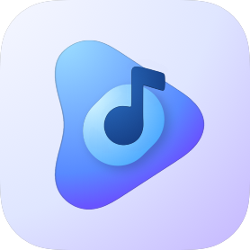
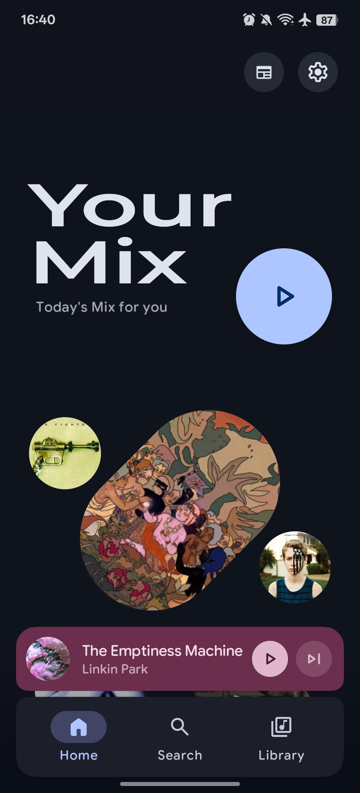
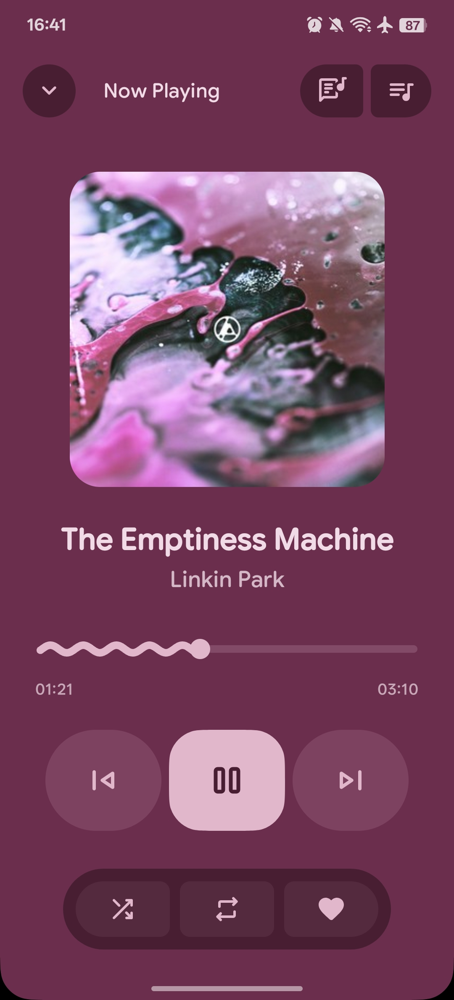
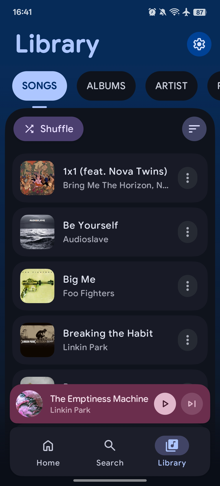
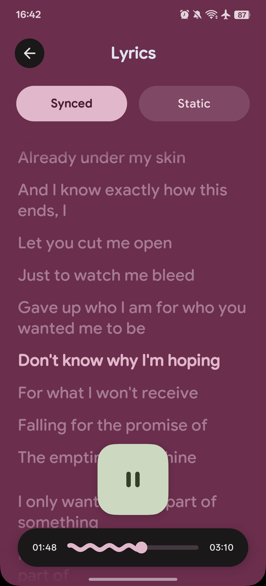

# PixelPlayer — неофициальный форк @poltoraska 🎵

<p align="center">
  
</p>

<p align="center">
  <strong>Музыкальный плеер для Android с интерфейсом на Jetpack Compose и Material Design 3</strong><br>
  Адаптация для планшетов и Fold, кассетный интерфейс и доработанная русская локализация
</p>

> **Это не официальный репозиторий PixelPlayer.** Это личный форк [@poltoraska](https://github.com/poltoraska) с собственными изменениями интерфейса, навигации и первоначальной настройки приложения. Репозиторий форка: [poltoraska/PixelPlay-MyMod](https://github.com/poltoraska/PixelPlay-MyMod).
>
> Исходный проект создан [theovilardo](https://github.com/theovilardo): [оригинальный репозиторий PixelPlayer](https://github.com/theovilardo/PixelPlayer). Авторы оригинального проекта не отвечают за изменения и поддержку этого форка. Об ошибках этой версии сообщайте в [Issues форка](https://github.com/poltoraska/PixelPlay-MyMod/issues).

<p align="center">
  
  
  <a href="https://github.com/poltoraska/PixelPlay-MyMod">
    
  </a>
</p>

## ✨ Что добавлено в этом форке

### Планшеты и складные устройства

- Сворачиваемая боковая навигация с разделами «Главная», «Поиск», «Библиотека» и «Настройки».
- Двухпанельная библиотека: список слева, выбранный альбом, исполнитель или плейлист справа.
- Настройки с постоянным списком разделов и открытием их содержимого в соседней панели.
- Полноэкранный планшетный плеер с очередью справа и без боковой навигации.
- Компоновка плеера для Fold в режиме tabletop: обложка над горизонтальным сгибом, управление под ним.
- Адаптивные страницы онбординга и диалоги первоначальной настройки.
- Мягкие пружинные переходы между основными вкладками и доработанные анимации панелей.

### Кассетный интерфейс

- Карточки альбомов в виде кассет при отображении библиотеки списком.
- Одна кассета в строке на смартфонах, две на планшетах и одна при открытой панели альбома.
- Вращение катушек у воспроизводимого альбома с остановкой на паузе.
- Отдельный кассетный плеер для смартфона в горизонтальной ориентации: переключение треков в центрах катушек, воспроизведение между ними, прогресс и дополнительные действия снизу.
- Общая анимация катушек с учётом жизненного цикла приложения и системного отключения анимаций.

### Интерфейс и удобство

- Переработанная главная страница, адаптивная статистика и выровненные заголовки.
- Полные названия альбомов и обновлённый блок информации об альбоме.
- Связанная группа кнопок «Воспроизвести» и «Перемешать» с переключением воспроизведения и паузы.
- Автоматический переход в библиотеку при открытии альбома по обложке из планшетного плеера.
- Виброотклик нижней навигации на смартфонах с учётом пользовательской настройки.
- Доработанная передача обложки в стандартный музыкальный пульт Wear OS.

### Русский язык и первоначальные настройки

- Дополненная русская локализация настроек и связанных диалогов.
- Кириллический шрифт Nunito, согласованный с оформлением Google Sans, и более выразительные заголовки.
- Корректные переносы коротких предлогов и союзов в локализованных строках.
- Поиск и библиотека по умолчанию отображаются списком.
- Порядок вкладок при первом запуске: «Альбомы», «Исполнители», «Песни», «Плейлисты», «Папки», «Избранное».
- Уже сохранённые пользовательские настройки не перезаписываются новыми значениями по умолчанию.

## 🖼️ Скриншоты

Ниже сохранены иллюстрации из исходного README. Они показывают базовый интерфейс PixelPlayer и могут отличаться от текущего оформления форка.

<p align="center">
  
  
  
  
</p>

## 🎵 Основные возможности PixelPlayer

### Современный интерфейс

- **Material You** — динамические цвета на основе обоев устройства.
- **Анимации** — переходы между экранами и отклик элементов управления.
- **Настройка оформления** — радиусы скругления и параметры навигационной панели.
- **Светлая и тёмная темы** — автоматическое или ручное переключение.
- **Цвета обложки** — оформление плеера на основе изображения альбома.

### Воспроизведение

- **Media3 ExoPlayer и FFmpeg** — воспроизведение аудио разных форматов.
- **Фоновое воспроизведение** — интеграция с системной медиасессией.
- **Очередь** — изменение порядка треков перетаскиванием.
- **Перемешивание и повтор** — управление порядком воспроизведения.
- **Воспроизведение без пауз** — непрерывные переходы между треками.
- **Кроссфейд** — настройка плавного перехода между композициями.

### Медиатека

- **Форматы** — MP3, FLAC, AAC, OGG, WAV и другие.
- **Разделы** — песни, альбомы, исполнители, жанры и папки.
- **Несколько исполнителей** — настраиваемые разделители в названиях исполнителей.
- **Исполнитель альбома** — группировка и организация альбомов по метаданным.
- **Выбор папок** — настройка каталогов для сканирования и исключений.

### Поиск и подборки

- **Поиск по медиатеке** — поиск композиций, альбомов и исполнителей.
- **Daily Mix** — персональные подборки на основе истории прослушивания.
- **Плейлисты** — создание и редактирование собственных списков воспроизведения.
- **Статистика** — история прослушивания и сведения о музыкальных предпочтениях.

### Тексты песен

- **Синхронизированные тексты** — поддержка LRC и поиск через LRCLIB API.
- **Редактирование** — добавление и изменение текстов композиций.
- **Прокрутка** — отображение текста по мере воспроизведения.

### Изображения исполнителей

- **Интеграция с Deezer** — автоматическая загрузка изображений через API.
- **Кэширование** — хранение изображений в памяти и базе данных для повторного использования.
- **Изображения-заглушки** — оформление на случай отсутствия фотографии.

### Подключения и дополнительные функции

- **Chromecast** — трансляция музыки на телевизор или совместимую акустику.
- **Виджеты** — управление воспроизведением с главного экрана через Glance.
- **Редактор тегов** — изменение метаданных с помощью TagLib, включая MP3, FLAC и M4A.
- **Плейлисты с ИИ** — генерация подборок с поддержкой Gemini, DeepSeek, OpenAI и других поставщиков.
- **Android Auto** — в исходном README эта возможность обозначена как планируемая.

## 🛠️ Технологии

| Категория | Технология |
|-----------|------------|
| Язык | [Kotlin](https://kotlinlang.org/) |
| Интерфейс | [Jetpack Compose](https://developer.android.com/jetpack/compose) |
| Дизайн | [Material Design 3](https://m3.material.io/) и выразительные компоненты Material |
| Аудиодвижок | [Media3 ExoPlayer](https://developer.android.com/guide/topics/media/media3) и FFmpeg |
| Архитектура | MVVM, StateFlow и SharedFlow |
| Внедрение зависимостей | [Hilt](https://dagger.dev/hilt/) |
| База данных | [Room](https://developer.android.com/training/data-storage/room) |
| Сеть | [Retrofit](https://square.github.io/retrofit/) и OkHttp |
| Изображения | [Coil](https://coil-kt.github.io/coil/) |
| Асинхронные операции | Kotlin Coroutines и Flow |
| Фоновые задачи | WorkManager |
| Метаданные | [TagLib](https://github.com/nicholaus/taglib-android) |
| Виджеты | [Glance](https://developer.android.com/jetpack/compose/glance) |

## 📱 Требования к устройству

- Android 11 (API 30) или новее.
- Для комфортной работы рекомендуется 6 ГБ оперативной памяти.

## 🚀 Сборка и запуск

### Необходимые инструменты

- Android Studio с поддержкой версии Android Gradle Plugin, указанной в [каталоге версий](gradle/libs.versions.toml).
- Android SDK Platform 37; минимальная версия Android для установки приложения — API 30.
- JDK 21.
- Gradle Wrapper из репозитория; отдельно устанавливать Gradle не требуется.

Актуальные параметры сборки находятся в [app/build.gradle.kts](app/build.gradle.kts), [gradle/libs.versions.toml](gradle/libs.versions.toml) и [gradle-wrapper.properties](gradle/wrapper/gradle-wrapper.properties).

### Порядок действий

1. Клонируйте **этот форк**:

   ```sh
   git clone https://github.com/poltoraska/PixelPlay-MyMod.git
   cd PixelPlay-MyMod
   ```

2. Откройте каталог проекта в Android Studio через **Open**.
3. Выберите JDK 21 для Gradle и дождитесь синхронизации зависимостей.
4. Подключите устройство с Android 11 или новее либо запустите подходящий эмулятор.
5. Выберите модуль `app` и нажмите **Run**.

Для отдельной проверки компиляции Kotlin:

```sh
./gradlew :app:compileDebugKotlin
```

Для запуска локальных JVM-тестов:

```sh
./gradlew :app:testDebugUnitTest
```

## ⬇️ Загрузка

- **Этот форк:** [релизы poltoraska/PixelPlay-MyMod](https://github.com/poltoraska/PixelPlay-MyMod/releases). Если опубликованных сборок нет, используйте инструкцию по сборке выше.
- **Исходный проект:** [релизы theovilardo/PixelPlayer](https://github.com/theovilardo/PixelPlayer/releases). Они относятся к оригинальному приложению и не содержат изменений этого форка.

## 📂 Структура проекта

```text
app/src/main/java/com/theveloper/pixelplay/
├── data/
│   ├── database/       # Сущности Room, DAO и миграции
│   ├── model/          # Модели: Song, Album, Artist и другие
│   ├── network/        # Сетевые API, включая LRCLIB и Deezer
│   ├── preferences/    # Настройки DataStore
│   ├── repository/     # Репозитории данных
│   ├── service/        # MusicService и HTTP-сервер
│   └── worker/         # Фоновые задачи WorkManager
├── di/                 # Модули внедрения зависимостей Hilt
├── presentation/
│   ├── adaptive/       # Адаптивная навигация и компоновка панелей
│   ├── components/     # Переиспользуемые компоненты Compose
│   ├── navigation/     # Граф навигации и переходы
│   ├── screens/        # Экраны приложения
│   └── viewmodel/      # ViewModel экранов
├── ui/
│   ├── glancewidget/   # Виджеты главного экрана
│   └── theme/          # Цвета, шрифты и темы
└── utils/              # Вспомогательные функции и расширения
```

## 🤝 Обратная связь и участие

Предложения и сообщения об ошибках этой версии оставляйте в [Issues форка](https://github.com/poltoraska/PixelPlay-MyMod/issues). В отчёте укажите устройство, версию Android, версию приложения, ориентацию экрана и шаги воспроизведения проблемы. Для Fold также полезно указать положение сгиба.

Изменения можно предложить через Pull Request в этот репозиторий. Приложите описание решаемой задачи и выполненных проверок. Учитывайте условия [лицензии проекта](LICENSE).

## 📄 Лицензия и авторство

PixelPlayer распространяется на условиях **Proprietary License**. Полный текст и ограничения использования приведены в [LICENSE](LICENSE). Статус неофициального форка не изменяет эти условия и права автора исходного проекта.

Части проекта, внесённые до 12 мая 2026 года, остаются доступны на условиях MIT. Подробности и сведения о сторонних компонентах находятся в [THIRD_PARTY_NOTICES.md](THIRD_PARTY_NOTICES.md). Лицензия шрифта Nunito включена в [nunito-OFL.txt](app/src/main/assets/licenses/nunito-OFL.txt).

- **Автор исходного проекта:** [theovilardo](https://github.com/theovilardo).
- **Автор изменений этого форка:** [poltoraska](https://github.com/poltoraska).
